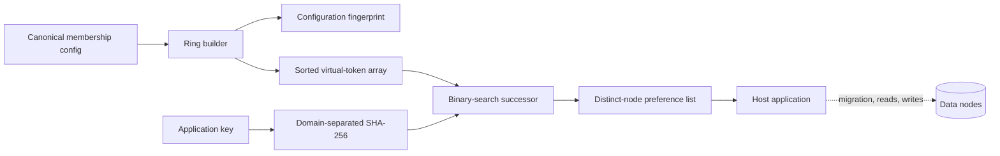

# Architecture

## System boundary

This repository implements the deterministic placement decision in a sharded system. It answers “which distinct physical nodes should own this key under this exact membership configuration?” It does not copy bytes, check node health, elect a configuration owner, or prove that replicas contain the same data.



The solid path is implemented here. The dotted path belongs to the embedding system.

## Core model

- A physical node has a stable ASCII identifier and integer weight from 1 to 100.
- Each node receives `virtualNodes * weight` deterministic tokens in a 64-bit ring.
- Tokens are ordered by unsigned value, then node ID, then replica index. The tie-breaker makes even deliberate hash collisions deterministic.
- A key is mapped to the first token clockwise at or after its hash. Replica candidates continue clockwise but skip repeated physical nodes.
- The ring is immutable. Adding or removing a member constructs a new snapshot, so one lookup never observes a partially mutated array.
- The SHA-256 input domains for node tokens and keys differ. Both use the first unsigned 64-bit big-endian word and declare hash version `sha256-u64be-v1`.

## Invariants

1. The same normalized membership, weights, virtual-node count, hash version, and key produce the same preference list.
2. Membership input order cannot change the ring fingerprint or placement.
3. A preference list never repeats a physical node.
4. Adding one physical node can only move primary ownership to that node.
5. Removing one physical node can only move keys whose primary was that node.
6. A configuration fingerprint changes when placement-relevant configuration changes.

Invariants 4 and 5 describe the ring algorithm. They do not say the host has migrated data safely.

## Complexity and capacity estimate

Let `P` be physical nodes and `V = sum(weight * virtualNodes)` be ring entries.

- Build: `O(V log V)` time and `O(V)` memory.
- Primary lookup: one SHA-256 plus `O(log V)` binary search.
- Preference list: binary search plus a clockwise scan until `R` distinct physical nodes are found. The common case is close to `O(log V + R)`; pathological token clustering can scan more entries.
- Example assumption: 100 equal-weight nodes and 256 virtual nodes create 25,600 entries. That is an entry count, not a byte-size or throughput promise.

The benchmark records a local runtime receipt for that example. It is deliberately not converted into a production QPS or latency SLA.

## Failure windows

| Window | Observable risk | Required host behavior |
|---|---|---|
| Two clients use different fingerprints | Split placement and inconsistent reads | Reject or quarantine requests until configuration converges |
| New ring activates before data copy | Reads route to an empty new owner | Stage copy, validate, then cut over; or use bounded dual-read/write |
| Old owner is cleaned before convergence | Irrecoverable missing data | Gate cleanup on migration and rollback receipts |
| Node is unhealthy but remains in membership | Preference list includes an unavailable owner | Health-aware request policy outside this pure ring |
| Hash version changes | Broad remapping | Treat as a migration, never a silent library upgrade |
| One logical key dominates traffic | One owner remains hot | Split/salt that workload or use application-aware routing |

## Data and API contracts

Library entry points:

```js
const ring = new ConsistentHashRing([
  { id: 'cache-a', weight: 1 },
  { id: 'cache-b', weight: 2 },
], { virtualNodes: 256 });

ring.locate('order-42', { replicas: 2 });
ring.snapshot();
ring.ownership();
ring.withNode('cache-c');
ring.withoutNode('cache-a');
```

The CLI exposes `locate`, `ring`, and sampled `simulate` commands. Every invocation emits exactly one JSON success or error envelope, making receipts machine-readable. CLI output is a decision or simulation; it is never a migration command.
